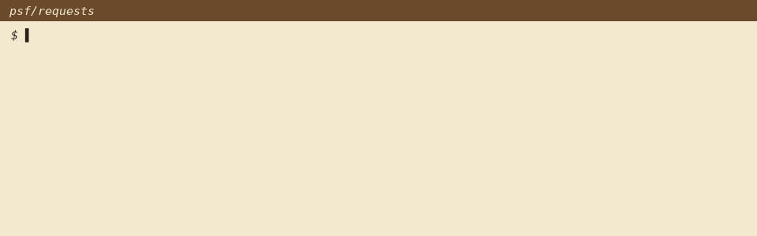

<p align="center"></p>

<h1 align="center">linelore</h1>
<p align="center"><b>git blame tells you who. linelore tells you why.</b></p>
<p align="center"><a href="https://blackman99.github.io/linelore/">Home</a> · <a href="https://blackman99.github.io/linelore/docs/">Docs</a> · <a href="https://github.com/Blackman99/linelore/actions/workflows/ci.yml"></a></p>

## The problem

`git blame` gives you a commit and a one-line message. The real reason for a line usually lives somewhere else: the pull request description, the issue it fixed, the review thread where someone asked "why not X?". Getting there is five clicks per line, and it only works inside one editor plugin. People keep asking how to find the "why" behind old code ([Ask HN](https://news.ycombinator.com/item?id=46726249), [HN](https://news.ycombinator.com/item?id=47368874)).

linelore does the chain in one command: **line → commit → PR → closing issues → nearby review comments.** It works on **GitHub, GitLab and Gitea/Forgejo** (Codeberg included) and reads which one from your remote.



## Install

```bash
pipx install git+https://github.com/Blackman99/linelore
```

Python 3.9+, no dependencies. Works anonymously on public repos; tokens are optional and per forge:

| Forge | Detected from | Token |
|---|---|---|
| GitHub, GitHub Enterprise | `github.com`, hosts named `github.*` | `GH_TOKEN` / `GITHUB_TOKEN` / your `gh` login |
| GitLab, self-managed GitLab | `gitlab.com`, `salsa.debian.org`, `invent.kde.org`, …, hosts named `gitlab.*` | `GITLAB_TOKEN` |
| Gitea, Forgejo | `codeberg.org`, `gitea.com`, `code.forgejo.org`, hosts named `gitea.*` / `forgejo.*` | `GITEA_TOKEN` or `FORGEJO_TOKEN` |

Anything else: `--forge gitlab|gitea|github`, plus `--api https://git.example.com/api/v4` if the API isn't at the usual path.

## Usage

```console
$ linelore src/requests/adapters.py:420
src/requests/adapters.py:420  * If ``verify`` is a string, (i.e., it is a user-specified trust bundle)
  commit  a62a2d35d9  2024-05-22  Ian Stapleton Cordasco
          Allow for overriding of specific pool key params
  PR #6716  Allow for overriding of specific pool key params  (@sigmavirus24, merged 2024-05-24)
          https://github.com/psf/requests/pull/6716
          “This re-enables the use case of providing a custom SSLContext via a Transport Adapter as broken in #6655 and reported in #6715 Closes #6715”
  fixes #6715  SSLV3_ALERT_HANDSHAKE_FAILURE after upgrade from 2.31.0 to 2.32.2 [closed]
          https://github.com/psf/requests/issues/6715
  mentions  psf/requests#6655
```

Same command on GitLab, where it's a merge request (real output, gitlab.com/gitlab-org/cli):

```console
$ linelore internal/commands/packages/download/download.go:290
internal/commands/packages/download/download.go:290  if file.FileName == fileName && (latest == nil || file.ID > latest.ID) {
  commit  28cd7b06fe  2026-10-16  José M. Requena Plens
          fix(packages): verify the checksum of the newest file with the same name
  MR !4112  fix(packages): verify the checksum of the newest file with the same name  (@jmrp, merged 2026-10-16)
          https://gitlab.com/gitlab-org/cli/-/merge_requests/4112
          “`glab packages download` verifies the file it downloads against the SHA256 stored in the registry, and `fetchChecksum` took the first file in the package whose name matched (download.go#L308-312). The package files API lists files by ID ascending unless asked otherwise (package_…”
  fixes #8615  glab packages download checks a re-uploaded file against the checksum of its first upload [closed]
          https://gitlab.com/gitlab-org/cli/-/work_items/8615
  note    review comments skipped: gitlab.com only shows these to signed-in users; set GITLAB_TOKEN
```

`file:10-30` for a range (commits deduped), `--open` to open the PR/MR in your browser, `--json` for editors/scripts, `--offline` for local only, `--rev` to blame at a tag. Full docs: <https://blackman99.github.io/linelore/docs/>

## License

MIT
